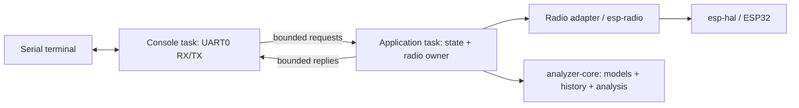

# Firmware architecture

## Boundaries

`analyzer-core` is `no_std`, forbids unsafe code, and has no HAL, executor,
serial, clock, or allocator dependency. It owns bounded domain models,
parsing, history, and AP-presence analysis. Timestamps are monotonic integers
passed in by firmware, making policy deterministic and host-testable.

`firmware` depends on `analyzer-core`. It alone selects the ESP32 chip and
owns HAL peripherals, the allocator, runtime, radio, and physical transport.
Vendor results and errors are translated in `platform/`, never leaked into
the core library. Use concrete adapters; introduce traits when a second
implementation or a substantive testing need justifies them.

The console task, command dispatch, and bounded streaming replies are implemented.
The application task owns radio operations, latest successful snapshot, history,
watch scheduling, and report generation. The console owns line editing and UART
output, preserving the current edited line as asynchronous reports arrive.
Use Embassy with esp-rtos's integration; do not add a second executor architecture
or scheduler. Run the application on one core initially.

## Task and resource ownership

| Resource | Sole owner | Policy |
|---|---|---|
| WIFI / WifiController | application task | One outstanding scan |
| AnalyzerState / latest snapshot / history | application task | Mutation via commands |
| UART0 RX and ordinary TX | console task | One writer; ASCII command echo |
| Request queue | console producer / application consumer | 4 entries; reject with Busy when full |
| Response queue | application producer / console consumer | 2 entries; bounded streamed chunks with explicit report completion |
| Watch stop signal | console producer / application consumer | Dedicated signal; active scans finish safely |

Do not send full scan snapshots through every queue. Stream bounded report
chunks or use a preallocated report buffer with explicit ownership. Do not hold
a mutex across an await or mix normal `println!` output into interactive prompts.
Bootstrap/panic output is the only exception. A stalled terminal must not create
unbounded reports or allocations.

The console selects between cancellation-safe UART reads and report replies,
giving ready replies priority. It uses a 128-byte line editor and a 1024-byte
report buffer, redraws an in-progress line after a status response, and writes
all UART bytes through one TX owner. The transport loops over partial writes.
No application mutex is held across an await.

CR, LF, and CRLF are accepted; CRLF submits once. Backspace/Delete edit a valid
line. Ctrl+U clears it. Ctrl+X, `stop`, or forwarded Ctrl+C stops future watch
repetitions after an active scan completes. On overflow, unsupported input, or
UART receive error, discard until the line boundary or an explicit clear;
never execute a truncated prefix. Current commands are ASCII; raw SSID data
remains byte-oriented in the model. Reports escape names to safe ASCII; when
the pinned driver's public API truncates a malformed UTF-8 SSID, an explicit
unavailable marker replaces the incomplete name.

Radio initialization failure leaves the console operational and produces a
faulted status. Current heap statistics are read as one allocator snapshot;
they are not whole-system free RAM or historical peak measurements.

## Scan lifecycle

Idle -> Scanning -> Idle after success or a recoverable driver error.
An unrecoverable driver state transitions to Faulted and requires controlled
reinitialization. Keep the last successful snapshot on failure. Publish a new
snapshot atomically only when all its observations have been normalized.

Watch scheduling uses absolute monotonic deadlines, skips missed deadlines,
and never queues catch-up scans. A finite count includes successful and failed
attempts, and the first attempt is due immediately. A stop request stops future
repetition; do not drop an
in-flight scan future unless driver cancellation safety has been established.
A hard timeout needs a documented driver stop/recovery sequence, not just a
timeout wrapper that silently cancels the operation.

## Data integrity

- Key AP records by BSSID, not SSID. SSIDs are up to 32 raw bytes.
- Escape control bytes and invalid UTF-8 when displaying network names.
- A missing AP is not a zero-dBm observation or proof of disappearance.
- Only eligible completed scans count toward missed-observation history.
  Single-channel scans do not mark other channels missing; capped results
  cannot establish absence.
- Attach scan ID, duration, coverage, completion time, and completeness flag.
- AP density is an indicator, not airtime, throughput, or packet loss.
- Driver-reported security is advertised configuration, not a security audit.

## Memory and errors

Initial limits: 32 APs per scan, 16 RSSI samples per tracked AP, 128 command
bytes, 4 requests, 2 responses, and a 1024-byte report chunk. The history store evicts the least
recently observed entry deterministically and reports eviction counts.

The configured scan set is channels 1..11. Full scans visit those channels
individually and merge their observations; single-channel scans must remain
inside the same configured set. This bounds observed coverage without assuming
the user's location or claiming to change the pinned driver's default region.
Only returned observations are sorted by RSSI; a result-cap warning preserves
the distinction between these observations and all APs in the environment.

The core allocates no heap. The radio does: startup uses the generator's
98,768-byte reclaimed-RAM allocation. This is a starting point, not an established
whole-system RAM budget. Record linker sections, task/future sizes, and measured
heap low-water marks before release. No PSRAM assumption is made.

External input and recoverable driver failures use typed errors. Panics are
reserved for impossible startup/programmer failures. Do not blindly feed a
watchdog from a task that can hide a stalled scanner; define progress criteria
when implementing watchdog supervision.

## Future extensions

Add HTTP as a second command/report transport after v0.1. Add flash persistence
behind a storage adapter with explicit partitions and recovery semantics.
Packet capture needs a separate short callback -> bounded sample queue -> worker
pipeline; callbacks must not format output, wait on channels, or retain borrowed
driver buffers. Do not create empty modules for these extensions now.
